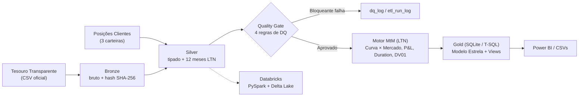
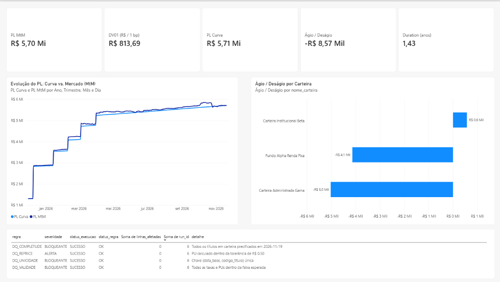

# mtm-rf — Motor de Marcação a Mercado (MtM) e Governança de Dados

Pipeline ETL enxuto e auditável para **precificação e Marcação a Mercado (MtM)** de carteiras de renda fixa de terceiros (**LTN — Tesouro Prefixado**), comparando **Valor na Curva** vs. **Valor a Mercado**, com **Quality Gate**, **modelo estrela SQL** e **versão PySpark/Databricks**.

---

## Arquitetura (Medallion)



---

## Dashboard (Power BI)



---

## O que o projeto entrega

1. **Precificação de LTN (base 252 dias úteis ANBIMA):**
   - `PU = 1000 / (1 + taxa)^(du / 252)`
   - **Valor na Curva** (taxa de compra) vs. **Valor a Mercado / MtM** (taxa do dia), **Ágio/Deságio**, **P&L diário**, **Duration Modificada** e **DV01**.
   - Validado via *golden tests* contra os PUs oficiais publicados pelo Tesouro Direto (diferença de R$ 0,00).
2. **Governança e Qualidade de Dados (`src/mtm/quality.py`):**
   - `DQ_UNICIDADE` *(Bloqueante)*: sem duplicatas em `(data_base, codigo_titulo)`.
   - `DQ_VALIDADE` *(Bloqueante)*: taxa entre 0% e 50% a.a. e PU > 0.
   - `DQ_COMPLETUDE` *(Bloqueante)*: todo título em carteira possui preço na data mais recente.
   - `DQ_REPRICE` *(Alerta)*: PU calculado pela fórmula bate com o PU publicado pelo Tesouro.
   - Rastreabilidade completa via `run_id` ligando cada linha da Gold ao `etl_run_log` e ao `dq_log`.
3. **Banco SQL (Modelo Estrela) + Databricks:**
   - Execução local em SQLite (`data/gold/mtm_rf.db`) + scripts equivalentes em **T-SQL / SQL Server** (`sql/ddl_sqlserver.sql`, `sql/views_analiticas.sql`, `sql/queries_exemplo.sql`).
   - Notebook **PySpark + Delta Lake** (`databricks/silver_to_gold.py`) com `MERGE INTO` idempotente.
   - Exportação automática de CSVs na pasta `data/gold/` prontos para conectar no **Power BI**.

---

## Como rodar

```bash
# 1. Instalar dependências
pip install -r requirements.txt

# 2. Rodar o pipeline baixando dados atualizados do Tesouro Transparente
PYTHONPATH=src python -m mtm run

# (Ou rodar offline usando a amostra real de 12 meses versionada em data/sample/)
PYTHONPATH=src python -m mtm run --offline

# 3. Rodar os testes automatizados
pytest
```

> No Windows (PowerShell), use `$env:PYTHONPATH="src"; python -m mtm run --offline`.

---

## Limitações conhecidas e próximos passos
- **Fonte de preço:** o projeto usa os preços/taxas públicos do Tesouro Direto como *proxy* de mercado. Em produção institucional, a fonte primária seriam as **taxas indicativas ANBIMA** conforme o Manual de Marcação a Mercado.
- **Evoluções futuras:** incluir NTN-F, LFT, NTN-B e títulos de crédito privado (curva + spread).

---

## Documentação
- [Dicionário de Dados](docs/dicionario_dados.md)
- [Runbook de Sustentação](docs/runbook.md)
